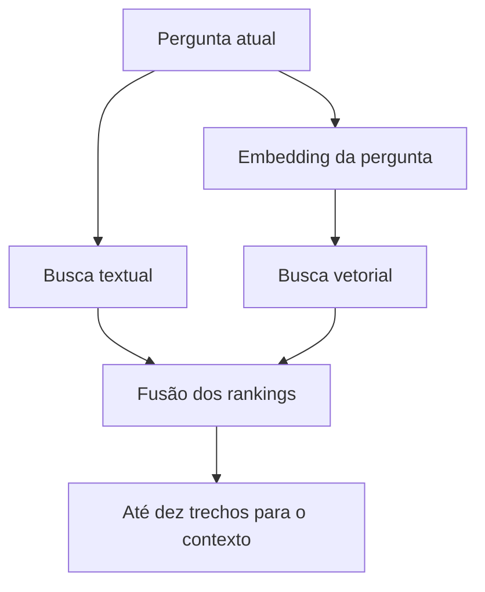

# Busca híbrida

Criado em: 2026-10-18 · Atualizado em: 2026-10-23

## O que é

Busca híbrida combina formas diferentes de procurar informações. Neste projeto, ela reúne **busca vetorial**, que aproxima textos pelo significado de seus embeddings, e **busca textual**, que considera os termos presentes no texto.

Essas estratégias se complementam: uma pergunta pode usar palavras diferentes das notas, enquanto um nome técnico pode ser importante para localizar um trecho específico. A combinação procura aproveitar os dois sinais, mas sua vantagem precisa ser medida na base do projeto.

## Como usamos no TCC

Em [database_utility.py](../../backend/database_utility.py), a indexação armazena os trechos e seus vetores no LanceDB e cria um índice textual com `create_fts_index("text", replace=True)`.

Na consulta, `retrieve_context()` gera o embedding da pergunta e executa:

```python
resultados = (
    table.search(query_type="hybrid")
    .vector(vetor_query)
    .text(pergunta)
    .metric("l2")
    .limit(10)
    .to_list()
)
```

`vector()` fornece a consulta vetorial; `text()` fornece a consulta textual. A métrica `l2` pertence à busca vetorial. O resultado final é limitado a dez trechos, não necessariamente dez documentos diferentes. Em seguida, trechos com score abaixo de `MIN_SCORE` (ou de `--min_score`) são descartados, e `--label_chunks` prefixa cada trecho com o título do documento de origem antes de montar o contexto.



A documentação do LanceDB descreve essa combinação e o uso de um reranker para reunir os resultados em uma ordem final. O projeto não escolhe explicitamente um reranker; depende do padrão da biblioteca. Consulte [Hybrid Search — LanceDB](https://docs.lancedb.com/search/hybrid-search).

## Exemplo concreto

Considere a pergunta **“Como me preparar para o nascimento do bebê?”**. A busca vetorial pode aproximá-la de trechos sobre plano de parto, mesmo sem essa expressão na pergunta. Já uma pergunta que contém um termo técnico usado nas notas pode aproveitar a correspondência textual.

Esse exemplo é ilustrativo: não representa uma consulta executada nem uma comparação de desempenho.

## Limites e cuidados

- A busca usa a mensagem atual; não reformula a pergunta a partir do histórico. Uma continuação como “e nesse caso?” pode fornecer poucos sinais para recuperar o trecho correto.
- As tags são armazenadas, mas a consulta atual não aplica filtros por tags.
- Com a estratégia `window`, a sobreposição entre chunks de um parágrafo longo pode trazer trechos parecidos de um mesmo documento e ocupar parte dos dez resultados.
- Um trecho bem colocado pode apenas tratar de um tema próximo, sem conter a resposta. O ranking não decide se a evidência é suficiente.

## Conceitos relacionados

- [Embeddings](embeddings.md) e [chunking](chunking.md).
- [Ranking e RRF](ranking-e-rrf.md).
- [Grounding e abstenção](grounding-e-abstencao.md).
- [Avaliação de RAG](avaliacao-de-rag.md).
