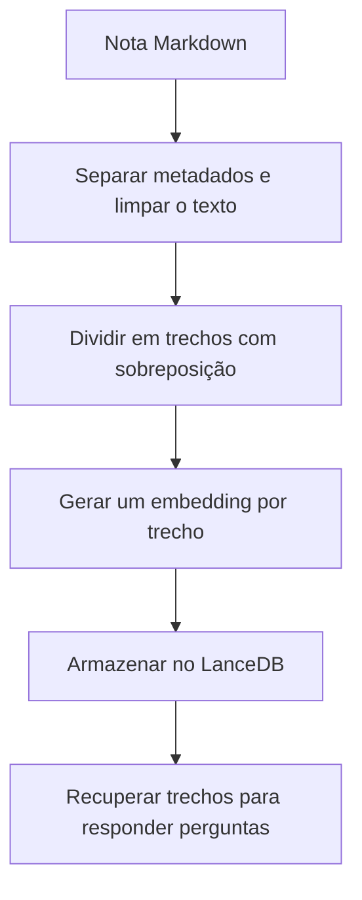

# Chunking e sobreposição

Criado em: 2026-10-13 · Atualizado em: 2026-10-13

## O que é

*Chunking* é a divisão de um texto em trechos menores, chamados *chunks*. No [RAG](rag.md), isso permite buscar partes de um documento relacionadas à pergunta, em vez de enviar o documento inteiro ao modelo de linguagem.

Cada trecho recebe seu próprio [embedding](embeddings.md). Assim, a busca pode encontrar uma parte específica da nota, mesmo quando o documento aborda vários assuntos.

A **sobreposição** (*overlap*) repete parte do conteúdo em trechos vizinhos. Isso ajuda a manter informações próximas de uma divisão disponíveis juntas, mas não garante que uma explicação inteira caiba em um único trecho.

## Configuração do projeto

A função `split_text_into_chunks()`, em [database_utility.py](../../backend/database_utility.py), divide o texto por tamanho e tenta ajustar as bordas em espaços ou quebras de linha.

Os valores atuais de [config.ini](../../backend/config.ini) são:

| Parâmetro | Valor | Significado |
|---|---|---|
| `CHUNK_SIZE` | 500 | Limite de caracteres por trecho. |
| `CHUNK_OVERLAP` | 100 | Sobreposição nominal de 100 caracteres, equivalente a 20% do tamanho configurado. |
| Avanço calculado | 400 | Diferença entre tamanho e sobreposição: `500 - 100`. |

**A unidade é caractere, não palavra nem token.** O código usa `len()` e recortes de strings Python para delimitar os trechos.

## Como a divisão funciona

1. Textos vazios ou compostos apenas por espaços não geram trechos. Espaços e quebras de linha nas extremidades do texto são removidos.
2. Se o texto tiver até 500 caracteres, ele é mantido como um único trecho.
3. Para textos maiores, a função calcula uma janela de até 500 caracteres.
4. Se a janela não chegar ao fim do texto, procura o último espaço ou quebra de linha dentro dela. Quando esse ponto fica depois da metade da janela, antecipa o corte para esse limite.
5. Salva o trecho sem espaços nas extremidades e avança a posição inicial em 400 caracteres.
6. Nas próximas janelas, pode recuar o início até depois de um espaço ou quebra de linha anterior, quando esse limite está a menos de 50 caracteres da posição inicial. Esse ajuste tenta evitar começar no meio de uma palavra.

O avanço é calculado a partir do início da janela, não do fim ajustado do trecho anterior. Por isso, **a sobreposição efetiva pode ser diferente de 100 caracteres**. O ajuste do início também influencia as posições seguintes.

Apesar da tentativa de preservar palavras, não há garantia absoluta: uma sequência longa sem espaços ou quebras de linha pode ser cortada.

## Exemplo concreto

Imagine uma nota com 900 caracteres. Sem considerar os ajustes das bordas, as janelas nominais seriam:

| Trecho | Posições no texto | Tamanho |
|---|---|---|
| Primeiro | 0 a 499 | 500 caracteres |
| Segundo | 400 a 899 | 500 caracteres |

As posições 400 a 499 aparecem nos dois trechos, formando a sobreposição nominal de 100 caracteres. Esse é um exemplo ilustrativo do cálculo; em uma nota real, os espaços e as quebras de linha podem alterar os limites.

Se uma explicação começa perto do final do primeiro trecho, a repetição pode permitir que o segundo também contenha esse início e sua continuação. Porém, uma informação distante, como o título da seção, pode ficar fora dos dois trechos.

## Onde entra no RAG

Na função `index_data()`, o projeto lê os documentos Markdown de `database/data_files`, separa os metadados do conteúdo e simplifica algumas notações LaTeX antes da divisão.

Cada trecho é armazenado com texto, vetor, identificação do documento e tags. O campo `nome_arquivo` recebe o título informado nos metadados ou, na ausência dele, o nome do arquivo sem extensão. Os limites de início e fim do trecho não são armazenados atualmente.

Embora alguns comentários do módulo mencionem parágrafos, a implementação divide o conteúdo por **janelas de caracteres**. Ela não separa primeiro por parágrafos, títulos, frases ou seções Markdown, nem repete automaticamente o título da seção em cada trecho.

## Limitações e próximos passos

- Um corte pode separar uma condição de sua explicação, uma lista de seu título ou uma linha de uma tabela. Preservar palavras não significa preservar o significado completo.
- Trechos menores podem perder contexto; trechos maiores podem reunir assuntos diferentes. A sobreposição acrescenta repetição e aumenta o volume de texto indexado.
- Não há avaliação registrada nesta nota que comprove que 500 caracteres com 100 de sobreposição sejam os melhores valores para a base.

Para avaliar essa configuração, podemos selecionar perguntas com respostas conhecidas nas notas e verificar se os trechos recuperados contêm a informação completa. Depois, comparar outros tamanhos ou uma divisão que considere seções Markdown, usando as mesmas perguntas.

Uma atenção prática: `needs_indexing()` verifica os arquivos e a configuração dos embeddings, mas não registra `CHUNK_SIZE` e `CHUNK_OVERLAP` na assinatura salva. Portanto, alterar apenas esses parâmetros não aciona automaticamente a reindexação. Para aplicar a nova divisão, é necessário reconstruir o índice; se o processo estiver em execução, reiniciá-lo também é necessário para carregar os novos valores da configuração.

## Referências no projeto

- [Divisão dos textos, indexação e detecção de mudanças](../../backend/database_utility.py).
- [Configuração de tamanho e sobreposição](../../backend/config.ini).
- [Conceito relacionado: Embeddings](embeddings.md).
- [Conceito relacionado: RAG](rag.md).
