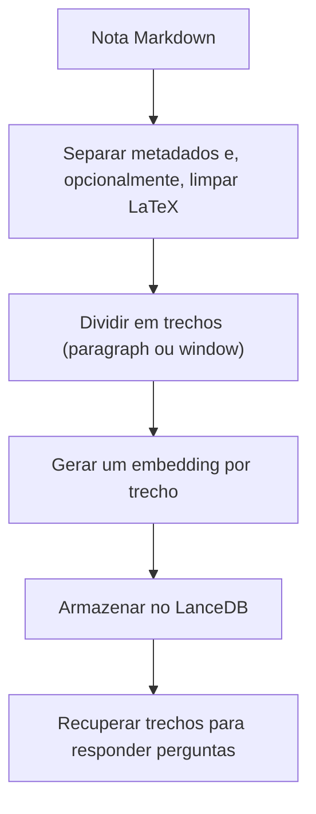

# Chunking e sobreposição

Criado em: 2026-10-13 · Atualizado em: 2026-10-23

## O que é

*Chunking* é a divisão de um texto em trechos menores, chamados *chunks*. No [RAG](rag.md), isso permite buscar partes de um documento relacionadas à pergunta, em vez de enviar o documento inteiro ao modelo de linguagem.

Cada trecho recebe seu próprio [embedding](embeddings.md). Assim, a busca pode encontrar uma parte específica da nota, mesmo quando o documento aborda vários assuntos.

A **sobreposição** (*overlap*) repete parte do conteúdo em trechos vizinhos. Isso ajuda a manter informações próximas de uma divisão disponíveis juntas, mas não garante que uma explicação inteira caiba em um único trecho.

## Estratégias do projeto

A estratégia é escolhida na inicialização do backend com `--chunking`. A divisão está em [chunking.py](../../backend/chunking.py).

| Estratégia | Como divide | Quando usar |
|---|---|---|
| `paragraph` (padrão) | Um trecho por parágrafo, separando o texto nas linhas em branco. | Notas com parágrafos curtos e independentes. |
| `window` | Agrupa parágrafos inteiros até o limite de `CHUNK_SIZE` caracteres e divide os parágrafos maiores que o limite com sobreposição. | Quando parágrafos muito curtos perdem contexto ou parágrafos muito longos reúnem assuntos demais. |

Os valores de `window` ficam em [config.ini](../../backend/config.ini):

| Parâmetro | Valor | Significado |
|---|---|---|
| `CHUNK_SIZE` | 500 | Limite de caracteres por trecho. |
| `CHUNK_OVERLAP` | 100 | Sobreposição máxima, em caracteres, entre trechos vizinhos de um parágrafo longo. |

**A unidade é caractere, não palavra nem token.**

## Como `window` funciona

1. Os parágrafos são lidos em ordem. Parágrafos vazios são descartados.
2. Um parágrafo cabe no trecho atual se o texto acumulado, unido por uma linha em branco, continuar com até 500 caracteres. Caso contrário, o trecho atual é fechado e o parágrafo inicia o próximo.
3. Um parágrafo com mais de 500 caracteres fecha o trecho atual e é dividido sozinho. Cada corte ocorre no último espaço ou quebra de linha dentro do limite; só há corte no meio de uma palavra se não houver espaço na janela.
4. O trecho seguinte de um parágrafo longo começa até 100 caracteres antes do corte anterior, avançado até o início da próxima palavra. Por isso, **a sobreposição efetiva costuma ser menor que 100 caracteres**.

A sobreposição só existe dentro de parágrafos longos. Parágrafos agrupados não se repetem entre trechos vizinhos.

## Exemplo concreto

Imagine uma nota com três parágrafos de 200, 250 e 700 caracteres:

| Trecho | Conteúdo | Observação |
|---|---|---|
| 1 | Parágrafos 1 e 2 | 200 + 250 + separador de 2 caracteres, abaixo de 500. |
| 2 | Início do parágrafo 3 | Até 500 caracteres, cortado em um espaço. |
| 3 | Fim do parágrafo 3 | Começa pouco antes do fim do trecho 2, repetindo parte dele. |

Com `paragraph`, a mesma nota geraria três trechos, um por parágrafo, sem repetição e sem limite de tamanho.

## Onde entra no RAG

Na função `index_data()`, o projeto lê os documentos Markdown de `database/data_files`, separa os metadados do conteúdo e, com `--clean_latex`, simplifica notações LaTeX dentro de trechos `$...$` antes da divisão.

Cada trecho é armazenado com texto, vetor, identificação do documento e tags. O campo `nome_arquivo` recebe o título informado nos metadados ou, na ausência dele, o nome do arquivo sem extensão. Os limites de início e fim do trecho não são armazenados.

Nenhuma das estratégias separa por títulos, frases ou seções Markdown, nem repete o título da seção em cada trecho.

## Reindexação

A assinatura salva em `database/index_memory.json` inclui a estratégia, `CHUNK_SIZE`, `CHUNK_OVERLAP` e o uso de `--clean_latex`. Mudar qualquer um deles reconstrói o índice na próxima mensagem. Com `paragraph`, tamanho e sobreposição são ignorados na comparação, pois não afetam a divisão.

## Limitações e próximos passos

- Um corte pode separar uma condição de sua explicação, uma lista de seu título ou uma linha de uma tabela. Preservar palavras não significa preservar o significado completo.
- Trechos menores podem perder contexto; trechos maiores podem reunir assuntos diferentes.
- Não há avaliação registrada que comprove que 500 caracteres com 100 de sobreposição sejam os melhores valores, nem que `window` supere `paragraph`.

Para comparar as estratégias, use o conjunto de perguntas descrito em [Avaliação de RAG](avaliacao-de-rag.md): gere o conjunto uma vez e verifique, para cada estratégia, se os trechos recuperados contêm a informação completa.

## Referências no projeto

- [Estratégias de divisão](../../backend/chunking.py).
- [Indexação e detecção de mudanças](../../backend/database_utility.py).
- [Configuração de tamanho e sobreposição](../../backend/config.ini).
- [Conceito relacionado: Embeddings](embeddings.md).
- [Conceito relacionado: RAG](rag.md).
