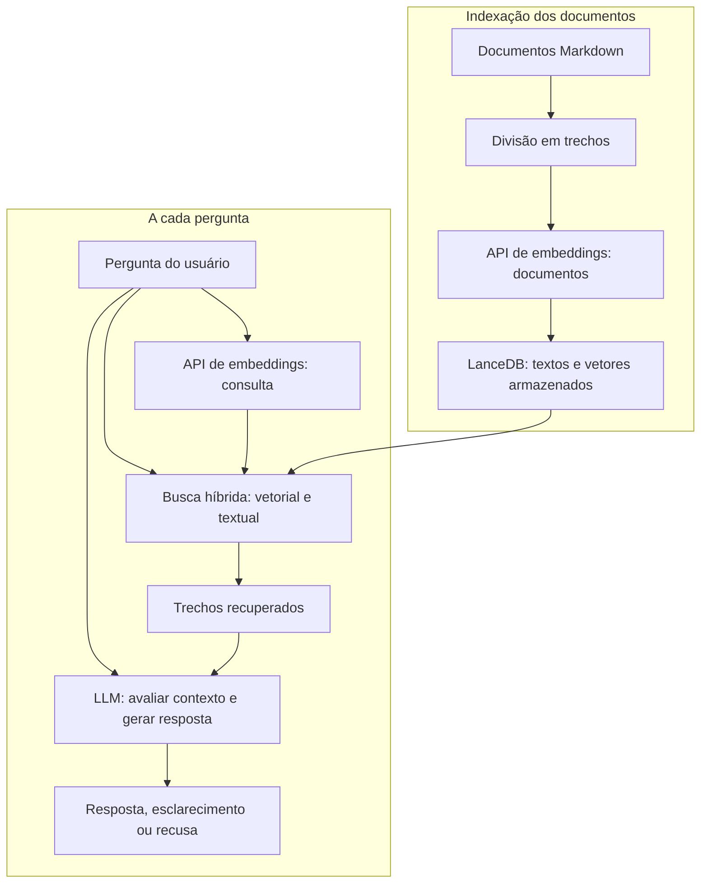

# Embeddings

Criado em: 2026-10-10 · Atualizado em: 2026-10-23

## O que são

Embeddings são representações de textos em vetores: listas de números produzidas por um modelo. Esses números permitem comparar textos pela proximidade de suas representações, ajudando a encontrar conteúdo relacionado mesmo quando a pergunta usa palavras diferentes das do documento.

Cada posição é uma dimensão do vetor. Não devemos interpretar uma posição isolada como uma palavra ou conceito específico. O número de dimensões depende do modelo: o `gemini-embedding-001` configurado no projeto gera vetores de **768 dimensões**; o modelo local de Sentence Transformers gera vetores menores.

O modelo de embeddings produz os vetores usados na busca. O LLM recebe os trechos encontrados e escreve a resposta ao usuário. São duas etapas com modelos e chamadas de API diferentes.

## Como usamos no TCC

O fluxo implementado é:

1. Dividir os documentos Markdown em trechos menores, chamados *chunks*.
2. Gerar um embedding para cada trecho e armazená-lo com o texto no LanceDB.
3. Gerar um embedding para a pergunta do usuário.
4. Buscar trechos relevantes, combinando busca vetorial e busca textual.
5. Enviar os trechos recuperados ao LLM do provedor escolhido (Ollama ou Gemini) para elaborar uma resposta ancorada na base.

A indexação prepara os vetores dos documentos para reutilização. A consulta gera o vetor da pergunta e combina a busca semântica com a textual; o LLM avalia se os trechos bastam para responder.

O provedor, escolhido com `--provider`, define também os embeddings. Com `gemini`, o projeto usa `gemini-embedding-001`, pela API do Google, com 768 dimensões. Com `ollama`, os embeddings são gerados localmente com Sentence Transformers ([local_embeddings.py](../../backend/local_embeddings.py)) e o LLM roda no Ollama. Trocar de provedor muda o espaço vetorial e provoca reindexação.

No provedor Gemini, o adaptador em [google_embeddings.py](../../backend/google_embeddings.py) usa `RETRIEVAL_DOCUMENT` para os documentos e `RETRIEVAL_QUERY` para perguntas. Também normaliza os vetores, dividindo seus componentes pelo comprimento do vetor.

## Exemplo da conversa

Perguntamos: **“O que você sabe sobre pré-parto?”**

Uma busca semântica pode recuperar um trecho sobre preparação ou plano de parto mesmo sem repetir exatamente “pré-parto”. Porém, a representação vetorial não garante que todos os resultados respondam à pergunta: pré-parto, parto prematuro e pós-parto são assuntos distintos.

No teste realizado, a busca encontrou um trecho sobre plano de parto, mas um filtro de score descartou esse resultado antes de enviá-lo ao LLM. O agente então recusou a pergunta por contexto insuficiente. O score de fusão por ranking (RRF) ordena os resultados das buscas; não é uma probabilidade de que um trecho seja correto ou suficiente. Por isso, o limite agora é configurável com `--min_score` (veja [Ranking e RRF](ranking-e-rrf.md)).

Esse caso mostra que uma resposta ruim pode vir da recuperação e da seleção dos trechos, mesmo quando a API de embeddings funciona.

## Indexação, compatibilidade e cotas

Os embeddings dos documentos são calculados durante a indexação e reutilizados nas consultas seguintes. A pergunta exige um vetor próprio para realizar a busca.

Ao trocar o modelo de embeddings ou a quantidade de dimensões, precisamos reindexar os documentos. Vetores produzidos por modelos diferentes não devem ser comparados como se pertencessem ao mesmo espaço, mesmo quando têm o mesmo número de dimensões. O projeto registra a configuração do embedding para detectar essa mudança.

Durante a migração, a API retornou `429 RESOURCE_EXHAUSTED`, identificando um limite de **100 por minuto** para embeddings no projeto Google usado naquele teste. Esse erro era de cota por minuto, não de autenticação nem de limite diário. O valor é uma observação daquele teste, não uma garantia para toda conta ou modelo.

Adicionamos lotes menores, espaçamento entre chamadas e espera baseada no `RetryInfo` retornado pelo Google. A primeira indexação pode demorar; consultas posteriores reutilizam os vetores armazenados. Em um teste real após a correção SSL, a API retornou um vetor com 768 dimensões.

## Limitações importantes

- Proximidade vetorial não comprova correção médica nem suficiência da evidência.
- A qualidade da busca depende dos documentos, da divisão em trechos, da pergunta e da seleção dos resultados.
- No provedor Gemini, usar a API evita carregar o modelo de embeddings localmente, mas exige internet e envia os textos ao provedor. O LanceDB continua local.

## Referências

- [Documentação de embeddings do Gemini](https://ai.google.dev/gemini-api/docs/embeddings).
- [Limites de uso da Gemini API](https://ai.google.dev/gemini-api/docs/rate-limits).
- [Configuração dos modelos no projeto](../../backend/config.ini).
- [Indexação e recuperação no LanceDB](../../backend/database_utility.py).
