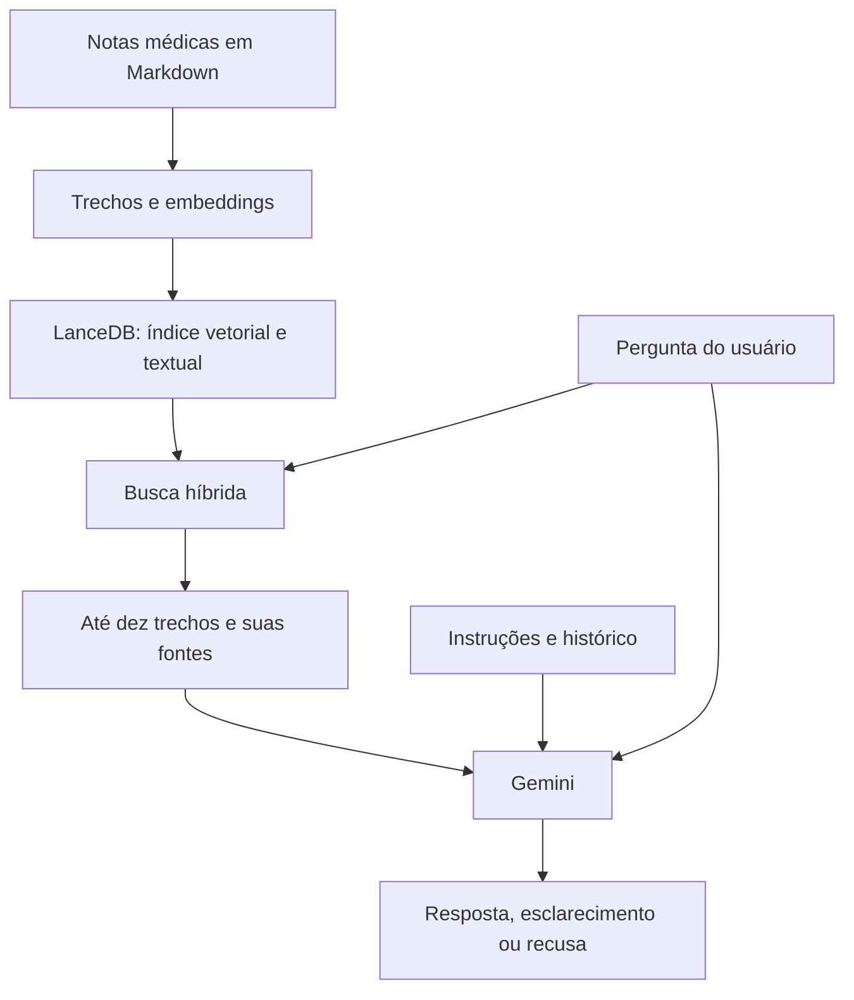

# RAG

Criado em: 2026-10-13 · Atualizado em: 2026-10-13

## O que é

RAG significa *Retrieval-Augmented Generation*, ou **geração aumentada por recuperação**. É uma técnica que busca informações em uma base de conhecimento e entrega os trechos encontrados a um modelo de linguagem para ajudá-lo a responder uma pergunta.

Pense em uma consulta a um material de referência antes de escrever uma resposta: primeiro o sistema procura conteúdo relacionado à dúvida; depois o modelo recebe esse conteúdo para elaborar a explicação. Isso permite usar documentos do projeto sem treinar novamente o modelo a cada atualização da base.

Os [embeddings](embeddings.md) são uma parte desse processo: representam textos em vetores para apoiar a busca por significado. O RAG inclui também a preparação dos documentos, a recuperação dos trechos, a montagem do contexto e a geração da resposta.

## Como usamos no TCC

O projeto utiliza RAG para apoiar respostas sobre Obstetrícia e Ginecologia com conteúdo de notas médicas em Markdown. O fluxo tem duas etapas principais.

### Preparação da base

Em [database_utility.py](../../backend/database_utility.py), o sistema lê os arquivos Markdown da pasta configurada em `NOTES_DIR`, simplifica algumas notações LaTeX e divide o texto em trechos menores, chamados *chunks*, com sobreposição. Essa sobreposição mantém parte do conteúdo entre trechos vizinhos para reduzir a perda de contexto nas divisões.

Cada trecho é armazenado na tabela `notas_medicas` do LanceDB com seu texto, embedding, identificação do documento e tags. Também é criado um índice de busca textual (FTS). Os embeddings são gerados pela API do Google, enquanto o banco LanceDB fica local.

Antes de processar uma mensagem, o sistema verifica se precisa reindexar a base, comparando os arquivos e a configuração dos embeddings com o estado salvo. Quando a indexação é executada, a tabela é reconstruída com os documentos disponíveis.

### Recuperação e resposta

Para uma pergunta comum do chat, o fluxo em [main.py](../../backend/main.py) é:

1. Gerar um embedding da pergunta.
2. Executar uma **busca híbrida** no LanceDB: a busca vetorial aproxima textos pelo significado, enquanto a textual procura correspondências no texto.
3. Recuperar até **dez trechos**, reunindo seus textos e as identificações dos documentos de origem.
4. Montar a entrada do Gemini com instruções do agente, histórico da conversa, trechos recuperados em `<contexto_local>`, fontes e pergunta atual.
5. Solicitar a resposta ao Gemini e acrescentar a pergunta e a resposta ao histórico.

A montagem dessa entrada está em [gemini_interaction.py](../../backend/gemini_interaction.py). O histórico é enviado ao modelo, mas a recuperação usa o texto da **pergunta atual**; o código não reescreve a pergunta com base nas mensagens anteriores antes de buscar.

## Exemplo concreto

Considere a pergunta: **“O que você sabe sobre pré-parto?”**

A busca pode encontrar trechos sobre preparação ou plano de parto, mesmo quando o texto usa palavras diferentes. Esses trechos são enviados ao Gemini para orientar a resposta. Se a dúvida estiver ampla, as instruções do agente permitem explicar o que estiver respaldado e pedir um esclarecimento breve.

Encontrar um trecho sobre parto prematuro ou pós-parto, porém, não significa que ele responda à pergunta sobre pré-parto. Recuperar conteúdo relacionado é diferente de recuperar evidência suficiente para responder.

Esse exemplo retoma o caso registrado na nota de [Embeddings](embeddings.md): um filtro descartava um trecho recuperado antes de enviá-lo ao modelo. O aprendizado para o RAG é que a seleção do contexto influencia a resposta tanto quanto a geração do texto.

## Regras e limites da implementação

As instruções em [config_agent.md](../../backend/config_agent.md) exigem que o modelo responda com base no contexto recuperado, reescreva as informações com suas próprias palavras e preserve os valores numéricos presentes nos trechos. Quando faltam informações suficientes, a resposta prevista é:

> Não encontrei dados ou critérios suficientes para esta conduta específica na minha base local de evidências.

Essas são **instruções para o modelo**, não uma validação automática da correção de cada resposta. O fluxo atual faz a recuperação e uma chamada de geração; não executa uma revisão clínica independente da resposta.

- O score de fusão por ranking (RRF), mencionado no código, serve para ordenar resultados. Ele não representa uma probabilidade de correção ou uma medida de suficiência da evidência. A recuperação atual não descarta resultados por um limiar desse score.
- Documentos incompletos, trechos mal divididos e perguntas ambíguas podem prejudicar a recuperação. O limite de dez resultados também restringe o conteúdo enviado ao modelo.
- Enviar as identificações das fontes ao Gemini não garante que cada afirmação da resposta tenha uma citação verificável.
- RAG ajuda a orientar a geração com material recuperado, mas não elimina respostas incorretas. A qualidade e a atualização das notas continuam essenciais.
- A base vetorial é local, mas os textos usados para gerar embeddings e a entrada de geração são enviados às APIs do Google.

## Referências no projeto

- [Indexação e recuperação](../../backend/database_utility.py).
- [Orquestração do chat](../../backend/main.py).
- [Montagem do contexto e chamada ao Gemini](../../backend/gemini_interaction.py).
- [Instruções do agente](../../backend/config_agent.md).
- [Conceito relacionado: Embeddings](embeddings.md).
