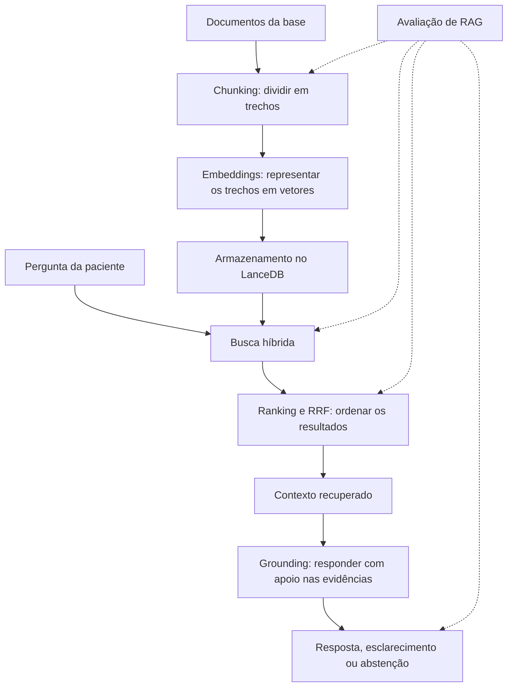

# Visão integrada dos conceitos de RAG

Criado em: 2026-10-19 · Atualizado em: 2026-10-19

Os sete conceitos documentados nesta pasta descrevem partes de um mesmo processo: transformar os documentos do projeto em evidências que possam sustentar uma resposta à paciente e verificar se isso funcionou.



RAG é a arquitetura que reúne esse fluxo. Chunking, embeddings, busca híbrida e ranking cuidam principalmente de preparar e encontrar informações. Grounding e abstenção orientam como usá-las. A avaliação mede a qualidade das etapas e do resultado.

## 1. RAG: consultar a base antes de elaborar a resposta

[RAG](rag.md) significa *Retrieval-Augmented Generation*, ou geração aumentada por recuperação. A ideia é fornecer ao modelo de linguagem informações recuperadas de uma base para que ele as use ao responder. No TCC, essa base é formada pelos documentos Markdown de `database/data_files`.

Imagine uma pessoa encarregada de responder dúvidas usando um conjunto de manuais. Para cada pergunta, ela procura as passagens pertinentes, lê essas passagens e escreve uma explicação. O RAG organiza um processo semelhante:

1. Recebe a pergunta.
2. Procura material relacionado na base.
3. Seleciona os trechos encontrados.
4. Entrega esses trechos ao modelo.
5. Solicita uma resposta fundamentada neles.

Isso permite atualizar as informações disponíveis ao sistema modificando a base, sem precisar treinar novamente o modelo a cada alteração.

No projeto, há duas fases. A **indexação** prepara os documentos: lê os Markdown, divide o conteúdo, gera embeddings e armazena os registros no LanceDB. A **consulta** acontece quando chega uma pergunta: gera a representação da pergunta, busca trechos, monta o contexto e chama o Gemini para responder.

Essa distinção explica por que os embeddings dos documentos podem ser reutilizados. Não é necessário recalculá-los para cada pergunta quando a base permanece igual.

Ter uma informação na base não garante que ela será usada na resposta. Ela precisa ser recuperada e chegar ao modelo. Depois disso, o modelo ainda precisa interpretá-la corretamente.

## 2. Chunking: escolher as unidades de informação pesquisadas

[Chunking](chunking.md) é a divisão de um documento em trechos menores, chamados *chunks*. Um documento pode abordar vários assuntos. Pesquisá-lo sempre como uma unidade inteira pode trazer muito conteúdo desnecessário para uma pergunta específica. Dividi-lo permite pesquisar partes menores.

A configuração documentada no projeto é:

| Parâmetro | Valor |
|---|---:|
| Tamanho máximo da janela | 500 caracteres |
| Sobreposição nominal | 100 caracteres |
| Avanço nominal | 400 caracteres |

A unidade é caractere, não palavra nem token. Sem considerar ajustes nas bordas, um texto de 900 caracteres poderia ser dividido assim:

```text
Primeiro trecho: posições   0 até 499
Segundo trecho: posições 400 até 899
```

Os caracteres de 400 a 499 aparecem nos dois trechos. Essa repetição é a sobreposição. A função tenta ajustar os limites em espaços ou quebras de linha para evitar alguns cortes no meio das palavras; por isso, os tamanhos e a sobreposição efetiva podem variar.

A sobreposição procura preservar relações que atravessam uma divisão. Imagine uma orientação que só vale sob determinada condição. Se o corte separar a condição da orientação, o sistema pode recuperar apenas uma delas e transmitir uma ideia incompleta.

A repetição pode ajudar, mas não garante que todas as relações importantes permaneçam juntas. Uma condição também pode estar no título da seção ou em um parágrafo distante.

| Trechos menores | Trechos maiores |
|---|---|
| Podem localizar informações mais específicas. | Podem preservar explicações mais completas. |
| Podem perder condições e referências próximas. | Podem misturar vários assuntos. |
| Produzem mais unidades para indexar. | Podem consumir mais espaço no contexto de geração. |

Nenhuma dessas escolhas é automaticamente melhor para toda base. As notas não apresentam uma avaliação que demonstre que 500 caracteres com 100 de sobreposição sejam os melhores valores.

Alterar apenas tamanho ou sobreposição não dispara automaticamente a reindexação pelo mecanismo atual. Para comparar configurações, é necessário garantir que o índice tenha sido reconstruído com a nova divisão.

## 3. Embeddings: pesquisar por significado

[Embeddings](embeddings.md) são representações de textos em vetores: listas de números produzidas por um modelo. No projeto, cada representação possui 768 dimensões. De forma ilustrativa:

```text
Trecho → [0,12; -0,08; 0,31; ...]
```

Esses números não são palavras codificadas individualmente. Uma posição isolada não deve ser interpretada como “parto”, “risco” ou outro conceito específico. O que interessa é a relação entre os vetores.

Textos relacionados podem produzir representações próximas, permitindo buscar conteúdo mesmo quando pergunta e documento usam expressões diferentes. Por exemplo, uma pergunta sobre preparação para o nascimento do bebê pode se aproximar de um trecho sobre plano de parto.

O modelo de embeddings representa os trechos durante a indexação e a pergunta durante a consulta. A busca compara o vetor da pergunta com os vetores armazenados.

É importante distinguir o modelo de embeddings do modelo que escreve a resposta. O primeiro produz representações para a recuperação. O segundo recebe os textos recuperados e gera a explicação.

Um embedding não verifica a evidência por si só. Proximidade pode indicar relação temática sem indicar que um trecho responde à pergunta. Pré-parto, parto prematuro e pós-parto pertencem a um domínio próximo, mas são assuntos distintos.

Os embeddings dependem da divisão do texto. Se um chunk perdeu uma condição necessária, o vetor será gerado a partir daquele conteúdo incompleto. A representação não recupera automaticamente o que ficou fora do trecho.

Ao trocar o modelo de embeddings, os documentos precisam ser representados novamente. Dois modelos podem produzir vetores com o mesmo número de dimensões e organizar seus espaços de maneiras diferentes.

## 4. Busca híbrida: combinar significado e correspondência textual

A [busca híbrida](busca-hibrida.md) combina duas formas de procurar conteúdo:

| Busca | Sinal utilizado |
|---|---|
| Vetorial | Proximidade entre representações dos textos. |
| Textual | Correspondências dos termos da consulta com o conteúdo indexado. |

Quando a paciente usa linguagem cotidiana e o documento usa uma expressão técnica, a busca vetorial pode aproximar as formulações. Quando a pergunta contém uma expressão específica presente nas notas, a busca textual pode fornecer um sinal útil.

A combinação procura aproveitar ambos os sinais, mas sua vantagem na base precisa ser avaliada. A consulta em [database_utility.py](../../backend/database_utility.py) fornece o vetor e o texto da pergunta:

```python
resultados = (
    table.search(query_type="hybrid")
    .vector(vetor_query)
    .text(pergunta)
    .metric("l2")
    .limit(10)
    .to_list()
)
```

A métrica `l2` pertence à parte vetorial. O resultado final é limitado a dez trechos, não necessariamente dez documentos diferentes. Vários podem vir da mesma nota, inclusive com conteúdo parecido por causa da sobreposição.

A recuperação utiliza a mensagem atual, enquanto o histórico é enviado posteriormente ao modelo de geração. Considere:

```text
Paciente: “Quero entender o plano de parto.”
Paciente: “E como faço isso?”
```

A segunda busca recebe uma frase que contém pouca informação sobre o assunto. O modelo de geração verá o histórico, mas a recuperação já terá acontecido. Assim, o modelo pode entender a continuação da conversa e receber trechos inadequados: compreensão da conversa e qualidade da recuperação podem divergir.

## 5. Ranking e RRF: decidir quais resultados vêm primeiro

[Ranking](ranking-e-rrf.md) é a ordem dos resultados. Essa ordem importa porque uma passagem útil que fique fora dos resultados selecionados não será enviada ao modelo.

Na busca híbrida, as partes vetorial e textual podem apresentar ordens diferentes:

| Posição | Busca vetorial | Busca textual |
|---|---|---|
| 1 | Trecho A | Trecho B |
| 2 | Trecho B | Trecho C |
| 3 | Trecho D | Trecho A |

O RRF, ou *Reciprocal Rank Fusion*, combina resultados usando suas posições nas listas. Na forma simples:

```text
score de um trecho = soma de 1 / (K + posição em cada lista)
```

`K` é uma constante que controla quanto as primeiras posições se diferenciam das seguintes. Não representa a quantidade de trechos recuperados. Uma lista em que o trecho está ausente não contribui para seu score.

Exemplo hipotético com `K = 60`:

| Trecho | Posição vetorial | Posição textual | Score aproximado |
|---|---:|---:|---:|
| A | 1 | Ausente | 0,01639 |
| B | 2 | 1 | 0,03252 |
| C | Ausente | 2 | 0,01613 |

O trecho B recebe contribuição das duas listas e fica primeiro. Essa estratégia evita somar diretamente valores de naturezas diferentes, como distância vetorial e pontuação textual.

No projeto, a escolha do reranker é delegada ao padrão da biblioteca; a aplicação não implementa a fórmula nem fixa explicitamente sua constante. A nota específica de ranking reúne as referências da biblioteca.

**Score de ranking não é probabilidade de correção.** Um resultado com score de 0,016 não possui “1,6% de confiança”. O número decorre da posição nas listas e da fórmula. Estar em primeiro também não comprova suficiência: se todas as opções forem inadequadas, ainda haverá uma primeira colocada.

A nota de embeddings registra um caso em que um trecho útil foi descartado por um filtro aplicado ao score. A recusa apareceu na resposta final, mas o problema estava na seleção do contexto. Isso conecta ranking e abstenção: uma decisão de recuperação pode fazer o modelo recusar mesmo quando a base possui a informação necessária.

## 6. Grounding e abstenção: estabelecer o que pode ser afirmado

[Grounding](grounding-e-abstencao.md), ou ancoragem, é fundamentar as afirmações nas evidências fornecidas. No TCC, isso significa usar os trechos recuperados da base local.

O modelo recebe o conteúdo dentro de `<contexto_local>`, junto das instruções, do histórico e da pergunta. A expectativa é preservar o significado das evidências ao explicá-las, incluindo condições, limitações e valores essenciais.

Considere uma estrutura hipotética:

```text
Evidência: “Na situação A, aplica-se a orientação B.”
Resposta: “A orientação B aplica-se em qualquer situação.”
```

A resposta reutilizou elementos da evidência, mas alterou seu alcance. Perdeu uma condição e deixou de estar adequadamente fundamentada. Parafrasear exige manter o significado mesmo quando as palavras mudam.

| Propriedade | Pergunta |
|---|---|
| Fidelidade | A resposta preserva o que a evidência diz? |
| Correção | A informação apresentada está correta? |
| Completude | A resposta cobre o necessário para a pergunta? |

Uma resposta pode ser fiel a uma fonte incorreta, correta mas incompleta, ou apresentar uma informação correta sem respaldo no contexto recuperado. Essas diferenças importam porque a regra do projeto é responder a partir da base.

A abstenção entra quando não há evidência suficiente. A frase prevista é:

> Não encontrei dados ou critérios suficientes para esta conduta específica na minha base local de evidências.

A recusa pode ocorrer porque a informação não existe na base, existe mas não foi recuperada, chegou incompleta, a pergunta é ambígua ou o modelo não reconheceu um contexto suficiente. Observar apenas a recusa não permite identificar a causa.

Perguntas ambíguas também podem justificar esclarecimento. Quando há conteúdo relacionado que permite uma explicação limitada, as instruções autorizam responder dentro desse respaldo e perguntar qual aspecto interessa à paciente.

No fluxo atual, avaliar a suficiência depende do modelo. Não há verificação independente de cada afirmação gerada. Os prompts de crítica e refinamento estão na configuração, mas não são executados em `process_chat()` de [main.py](../../backend/main.py).

## 7. Avaliação de RAG: descobrir onde o processo falha

A [avaliação de RAG](avaliacao-de-rag.md) verifica recuperação, geração e abstenção separadamente. Avaliar somente se a resposta parece boa pode esconder evidências erradas, interpretação inadequada ou recusa de uma pergunta respondível.

### Recuperação e ranking

**Recall@k** pergunta: das evidências relevantes de referência, quantas apareceram entre os primeiros k resultados? **Precision@k** pergunta: dos primeiros k resultados, quantos são relevantes?

Imagine uma pergunta que exige duas passagens e uma busca que retorna dez resultados. Se as duas passagens aparecem, o Recall@10 é `2/2 = 1`. Se apenas esses dois resultados são relevantes, a Precision@10 é `2/10 = 0,2`. O sistema encontrou tudo o que precisava, mas trouxe conteúdo desnecessário.

É preciso definir o que será contado: documentos, chunks ou passagens de evidência. Recuperar o documento certo pode ser insuficiente se o chunk selecionado não contém a informação necessária. Dois chunks sobrepostos podem representar uma mesma evidência; contá-los como acertos independentes pode distorcer a interpretação.

O **MRR** considera a posição do primeiro resultado relevante:

```text
Primeiro resultado relevante na posição 1 → contribuição 1
Primeiro resultado relevante na posição 2 → contribuição 0,5
Primeiro resultado relevante na posição 4 → contribuição 0,25
Nenhum resultado relevante                → contribuição 0
```

A média dessas contribuições forma o MRR. Ele observa se a primeira evidência aparece cedo, mas não verifica se todas as passagens necessárias foram encontradas.

### Geração e abstenção

Na geração, é necessário avaliar fidelidade, correção e completude com referências e critérios confiáveis. Na abstenção, dois comportamentos importantes são:

| Comportamento | Significado |
|---|---|
| Recusa correta | O sistema recusa uma pergunta sem resposta na base. |
| Recusa indevida | O sistema recusa uma pergunta que poderia responder. |

Também é necessário observar respostas dadas sem evidência suficiente. Um sistema que responde sempre pode extrapolar; um sistema que recusa sempre tem pouca utilidade.

### Situação do conjunto de testes

[gerar_testset.py](../../gerar_testset.py) cria perguntas sintéticas e referências. Ainda não constitui uma avaliação completa: não executa todas as perguntas no chat nem calcula essas métricas.

O conjunto exige revisão porque usa `my_notes` como origem padrão, enquanto o chat consulta `database/data_files`; gera perguntas a partir de um recorte maior que o contexto exportado; pode marcar uma pergunta como não respondível em um documento quando outro contém a resposta; e pode produzir referências em conflito com a proibição de formular diagnósticos.

O campo `ground_truth` identifica uma referência no arquivo, mas seu nome não comprova que ela esteja correta.

## Como os conceitos se influenciam

Uma escolha no início do fluxo altera as condições das etapas seguintes. Se o chunking separa uma condição de sua orientação, o embedding representa informação incompleta. A busca pode recuperar esse trecho e o ranking colocá-lo em primeiro. O modelo pode produzir uma resposta coerente com o fragmento, mas inadequada em relação ao documento completo. Modificar apenas o prompt pode não resolver a origem do problema.

Outra relação envolve sobreposição e diversidade. Mais sobreposição pode preservar contexto nas bordas, mas aumenta a repetição. Como o sistema envia até dez trechos, várias posições podem ser ocupadas por passagens semelhantes, deixando de fora evidências complementares.

Recuperação e abstenção também estão ligadas. Para o modelo, duas situações podem parecer iguais:

```text
A informação não existe na base.
A informação existe, mas não foi recuperada.
```

Em ambas, ele não recebe a evidência necessária. Por isso, a análise precisa consultar a base e os resultados recuperados, além da resposta final.

Ranking e grounding respondem a perguntas diferentes:

```text
Ranking:   “Quais resultados devem vir primeiro?”
Grounding: “Quais afirmações esses resultados permitem sustentar?”
```

Um score alto não resolve a segunda pergunta. Uma evidência pode estar bem posicionada e ainda ser insuficiente para a dúvida específica.

A avaliação permite testar essas decisões. Para saber se aumentar os chunks melhora as respostas, seria necessário reconstruir o índice, manter as demais condições controladas e comparar recuperação e geração nas mesmas perguntas. Trechos maiores podem preservar mais contexto e misturar mais assuntos; o resultado precisa ser observado.

## Exemplo completo no fluxo do TCC

Considere a pergunta: **“Como posso me preparar para o parto?”** Suponha, de forma ilustrativa, que a base contenha informações pertinentes.

O chunking determina se orientações e condições estão juntas em trechos pesquisáveis. Os embeddings permitem aproximar a pergunta de passagens que usam expressões como “plano de parto”. A busca híbrida combina significado e correspondências textuais. Ranking e RRF organizam os candidatos e influenciam quais entram no limite de dez resultados.

O RAG reúne os trechos, a pergunta, as instruções e o histórico na chamada ao Gemini. O grounding exige preservar o conteúdo sustentado por essas passagens. A abstenção orienta o comportamento quando o material é insuficiente; um esclarecimento pode ser adequado se a dúvida estiver ampla e houver respaldo para uma resposta limitada.

A avaliação verifica se as passagens necessárias chegaram ao modelo, se a resposta as utilizou corretamente e se a decisão de responder ou recusar foi adequada. Esse exemplo descreve o fluxo esperado, não uma execução ou validação realizada.

Para investigar uma resposta ruim, a sequência de perguntas é:

1. A informação necessária existe e está correta na base?
2. A divisão em chunks preservou essa informação?
3. A busca recuperou as passagens necessárias?
4. Elas entraram no contexto enviado ao modelo?
5. O modelo preservou seu significado?
6. A decisão de responder, esclarecer ou recusar foi adequada?

Essa sequência permite localizar a falha e escolher qual parte do projeto precisa ser ajustada.
